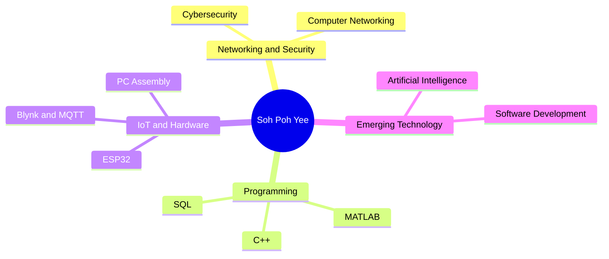

 

  

  

<h3><i>Learning today. Building tomorrow. Innovating through technology.</i></h3>

**[About](#about-me)** · **[Skills](#technical-skills)** · **[Focus Map](#technology-focus-map)** · **[Research](#research-interests)** · **[Projects](#featured-projects)** · **[Achievements](#achievements)** · **[Statistics](#github-statistics)** · **[Contact](#contact)**

 

<h2 align="center">About Me</h2>

<table>
<tr>
<td width="58%" valign="top">

Hi! I’m **Soh Poh Yee**, a student at **Universiti Teknologi Malaysia (UTM)**, currently studying **Networking and Security**.

I’m passionate about technology, programming, and understanding how digital systems work. I enjoy exploring new tools, participating in practical activities, and developing my technical skills through hands-on learning.

> 🎯 **My Goal:** To continuously develop my technical knowledge and become a capable technology professional who can create practical solutions to real-world problems.

</td>
<td width="42%" valign="top">

| | |
|:--|:--|
| 🎓 **Education** | UTM |
| 🌐 **Field** | Networking and Security |
| 💻 **Learning** | C++, MATLAB, Databases |
| 🔐 **Interests** | Cybersecurity, Networking |
| 🤖 **Exploring** | AI and IoT |
| 🛠️ **Hands-on** | PC Assembly, ESP32 |

</td>
</tr>
</table>

<h2 align="center">Technical Skills</h2>

<b>Languages & Databases</b> 

  

<b>IoT, Embedded & Hardware</b> 

  

<b>Tools</b> 

  

<b>Technical Areas</b> 

 

| Technology | Experience |
|:--|:--|
| 💠 **C++** | Programming fundamentals and problem-solving practice |
| 📈 **MATLAB** | Coursework and data processing exercises |
| 🗄️ **SQL / phpMyAdmin** | Database fundamentals and management practice |
| 📡 **ESP32 · Blynk · MQTT** | Sensor experiments and IoT monitoring |
| 🔧 **Git & GitHub** | Version control and portfolio management |
| 📝 **Visual Studio Code** | Main programming environment |

<h2 align="center">Technology Focus Map</h2>

<h2 align="center">Research Interests</h2>

| 🔐 Cybersecurity | 🌐 Networking | 🤖 Artificial Intelligence | 📡 IoT | 💻 Software Dev |
|:---:|:---:|:---:|:---:|:---:|
| Network protection, security fundamentals, system vulnerabilities | Infrastructure and communication technologies | AI applications and intelligent systems | Smart monitoring, sensors, automation | Application development and programming |

<h2 align="center">Featured Projects</h2>

<table>
<tr>
<td width="50%" valign="top">

### 🧾 Smart Attendance System
  

- Participated in planning a smart attendance system
- Explored system workflows and development planning
- Worked with project documentation and DFD concepts

🔗 [Add your project repository link]

</td>
<td width="50%" valign="top">

### ♻️ Smart Eco-Bin Concept
 

- Explored an intelligent waste-bin monitoring system
- Focused on overflowing bins and the lack of real-time monitoring
- Investigated how sensors could improve waste management

🔗 [Add your project repository link]

</td>
</tr>
<tr>
<td width="50%" valign="top">

### 📡 ESP32 IoT Experiments
 

- Explored ESP32 microcontroller programming
- Practised with temperature and humidity sensors
- Experimented with Blynk and MQTT for monitoring and communication

🔗 [Add your project repository link]

</td>
<td width="50%" valign="top">

### 🖥️ PC Assembly
 

- Participated in a hands-on PC assembly activity
- Explored computer components and their functions
- Gained practical exposure to hardware assembly

📸 [Add photos or activity link]

</td>
</tr>
</table>

<h2 align="center">Achievements</h2>

- 🎓 Currently pursuing studies at **Universiti Teknologi Malaysia**
- 🌟 Participated in **NALI 2026 – New Academia Learning Innovation**
- 🖥️ Participated in a practical **PC Assembly** activity
- 💡 Explored technology-related projects and practical learning activities
- 📚 Continuously developing programming and technical knowledge

<h2 align="center">GitHub Statistics</h2>

 

 

<h2 align="center">Contact</h2>

I’m always happy to connect with students, developers and people who share an interest in technology!

  

  

<h3>🌱 My Learning Philosophy</h3>

<i>“Great things are built one step at a time. Stay curious, keep learning, and never stop improving.”</i>

  

**Thanks for visiting my GitHub profile! ⭐**

